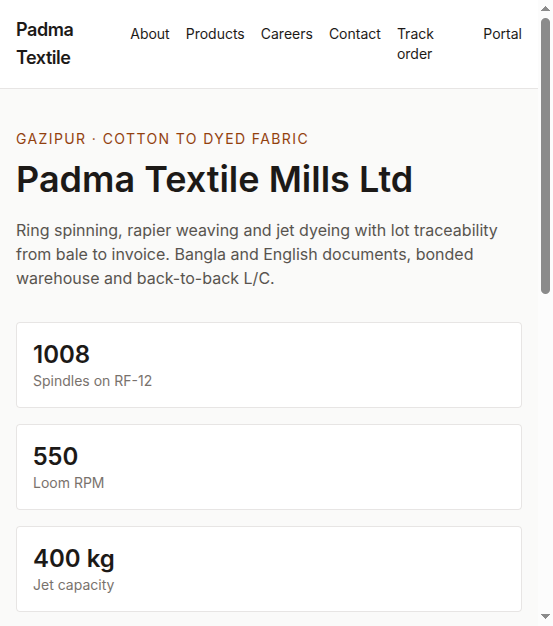
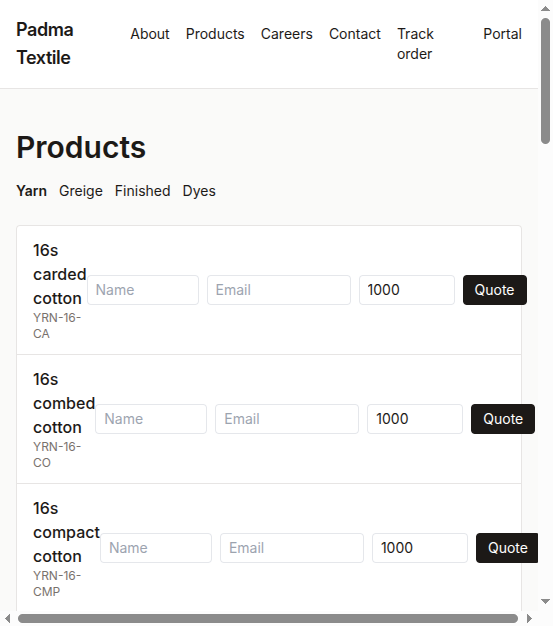
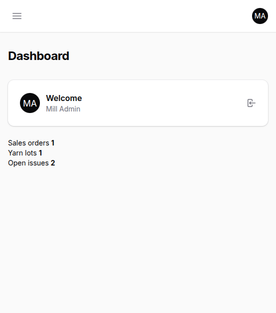
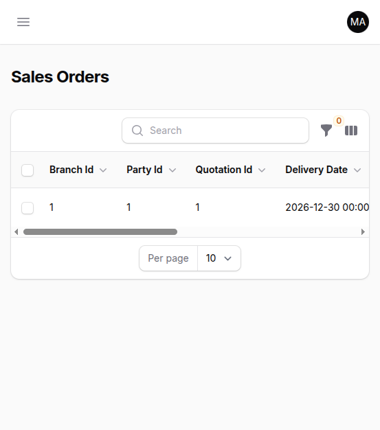
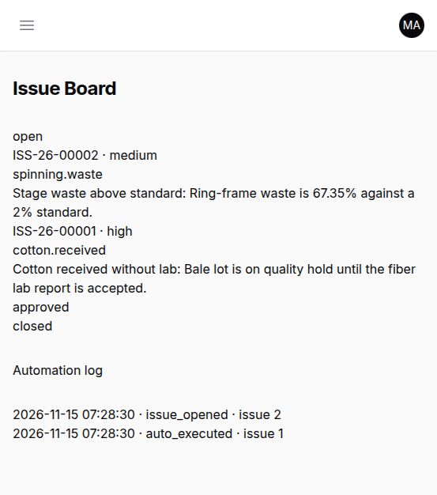

# Textile Mill ERP

Cotton in the godown. Yarn on the ring frame. Fabric on the loom. Shade in the jet. Invoice in the bank.

One mill system for spinning, weaving, knitting, dyeing, finishing, stores, gate, payroll, and export accounts. Built for a Bangladesh mill (BDT, Bangla and English, Bangla calendar, bonded warehouse, back-to-back L/C, VAT 15% and Mushak data) and configurable for any country.

The demo company is **Padma Textile Mills**, Gazipur. The brand name is a setting, not a hard code.

**Author:** [Imran Ahmed](https://imrandev.bd) · [me@imrandev.bd](mailto:me@imrandev.bd)

<p align="center">
  
  
  
</p>
<p align="center">
  
  
</p>

## What a mill gets back

A paper mill loses time in the same places every month. This system does that work while the shift is still running.

| The slow way | What happens here | Time a typical mill gets back |
|---|---|---|
| Accounts wait until the next week for production numbers | The invoice, the receipt, and the stock movement post a balanced journal the moment the document is saved. A daily MIS pack is scheduled for 07:00. | The two-week wait for “the production figure” |
| Quotes compared in a spreadsheet, then a PO typed again | Shortage raises an RFQ. Quotes rank themselves. One approval becomes the PO. A stale requisition escalates. | A day or two between “we are short” and “the bale is ordered” |
| Bales received, tested later, price argued after the mixing | The lot stays on quality hold until micronaire, staple, strength, trash, and moisture are in. The price adjusts from the test. The supplier scorecard moves. | The argument after the cotton is already spun |
| Waste and yield noticed when the month is closed | Stage waste is compared with the standard on the same shift. The demo ring frame opened an issue at 67% against a 2% standard. | Three to four weeks of unnoticed loss |
| Wrong laydown, found in the yarn test | The mixing plan picks bales closest to the target micronaire, staple, and strength, and checks consumption against the plan. | A whole lot of off-count yarn |
| Lab dip couriered, rejected, remade five times | The buyer approves or rejects the dip on the portal, with Lab and ΔE. The locked recipe scales to the bulk batch by liquor ratio and weight. | A week of shade samples |
| Chemicals written off at month end | The batch deducts dye and chemical from the store at the recipe quantity. A variance above tolerance opens an issue. | The store surprise, and the cost per kg you never saw |
| Shrinkage found after the carton is closed | Finishing records warp and weft shrinkage and can block release when the spec is missed. | A rejected shipment |
| Idle looms because the beam was not ready | Beam readiness and repeated stop reasons raise a maintenance issue before the shed stands. | A shift of stopped looms |
| Forged or unreturned gate passes | The pass is a numbered document. Returnable passes alert when overdue. Weighbridge weight against document weight opens an issue. | The material that left and never came back |
| Attendance and overtime calculated by hand | Device punches feed the day. Missing punches open an issue. Overtime above the Bangladesh weekly limit is blocked. Payslips print in Bangla. | The payroll weekend |
| LC maturity and buyer dues discovered late | Document and maturity dates alert ahead of the bank. Overdue invoices remind the buyer. Credit limit stops the next delivery. | A missed bank date, and a buyer over the limit |
| Audit week spent hunting certificates | Licences, training, and certificates remind at 90, 60, 30, and 7 days. | The night before the audit |

These are the delays a running mill already pays for. The rules are editable: change the waste percent, the redye limit, the OT cap, or the credit block without a code change.

## One order, already walked

`php artisan mill:install` loads Padma Textile and one export order, **SAL-26-00001**, from inquiry to bank realization:

1. Inquiry and a cost sheet (cotton, conversion, dyeing, packing, margin).
2. Quotation, approved, then the sales order.
3. Plan, fabric-to-yarn BOM, and the cotton MRP shortage.
4. Purchase requisition, purchase order, and a goods receipt on **quality hold**.
5. Mixing laydown, ring-frame production, and yarn lot **YL-30-001** traced to the bale.
6. Loom meters, a 4-point roll grade, and an AQL inspection.
7. Buyer-approved lab dip, recipe scaled onto a 400 kg jet batch, chemicals issued from store.
8. Stenter release, shipment, gate pass, commercial invoice.
9. Export L/C, BRC realization, and the cash journal.
10. A payroll line with overtime at twice the basic hourly rate.

The dashboard opens on that order, that yarn lot, and two live issues: the bale still waiting for the lab, and ring-frame waste above the standard.

## What you can run

Turn units on or off per company. A spinning-only mill hides weaving, knitting, and dyeing from menus, routes, and permissions. The data stays.

- **Multi-company and multi-unit.** Spinning Unit 1, Weaving Unit 2, Dyeing, head office, warehouse, depot. Every stock move, document, and journal knows its company and branch.
- **Multi-warehouse.** Raw cotton godown, yarn godown, greige, finished fabric, dye and chemical, spares, scrap. Lots, bales, cones, and rolls. FIFO or weighted average. Bonded stock separate from home stock.
- **Multi-currency.** BDT, USD, EUR, INR, CNY, with a rate on the document and a revaluation at period end.
- **Bangla and English.** Payslips, invoices, challans, and gate passes through Unicode PDF. Bangla calendar on dates. Bangla numerals when you want them.
- **People who actually work in a mill.** Admin, management, merchandiser, production, floor supervisor, QC, lab, store, purchase, accounts, HR, gate, maintenance, plus a buyer portal and a supplier portal.
- **Any mix of processes.** Spinning, weaving, knitting, wet processing, and a cut-make-pack hand-off. Job work in and out for dyeing, printing, and knitting.

## The floor, in the language of the floor

**Spinning.** Laydown and mixing. Blowroom, carding, drawing, combing, roving, ring frame, winding, packing. Production per spindle, efficiency, UKG, stage waste, cotton-to-yarn yield, count CV. A yarn lot remembers the mixing that made it.

Ring-frame kilograms:

`(RPM × 60 × hours) / (TPI × 36 × 840 × Ne) × 0.4536 × efficiency`

18,000 rpm, 8 hours, 20 TPI, Ne 30, 90% efficiency, one spindle: **0.1944 kg**.

**Weaving.** Warping, sizing, drawing-in, loom. Meters from RPM, PPI, minutes, and efficiency. Warp and weft kilograms from EPI, PPI, width, and count, with shrinkage and size add-on. Grey inspection on the 4-point system, with a 10-point option. Weaver incentive from the shift.

**Knitting.** Dia, gauge, feeders, stitch length, GSM, roll output, and the defect log.

**Wet processing.** Shade library and lab dip, with buyer approval on the portal. Recipe versions. Bulk scaling by percent on weight of fabric and liquor ratio. Jet, winch, beam, package, jigger, pad-batch. Reactive, disperse, vat, sulphur. Right-first-time, redye, and the cost of a strip. Pretreatment, printing, stenter, compactor, sanforizer. Water, steam, and power per kilogram. Effluent COD, BOD, pH, TDS, and colour.

**Planning.** Capacity, BOM explosion from the sales order back to cotton, MRP that can raise a requisition, and subcontract orders.

**Quality.** Incoming fiber and chemical tests. In-process sliver, yarn, shade, GSM, and width. Final 4-point, fastness, shrinkage, tensile, AQL sample size and accept/reject. NCR, 5-why, CAPA, and a customer claim that can find the lot.

**Costing.** Standard and actual at yarn, greige, and dyed fabric. Material, conversion, packing, overhead, margin. The quotation rate comes from the cost sheet. Cotton position: open purchase against open sales.

**Stores and gate.** GRN with quality hold, issue, return, transfer in transit, cycle count, ageing, reorder. Vehicle, driver, weighbridge, visitor pass, returnable gate pass.

**People.** Permanent, contract, piece-rate, daily wage, agency. Shifts, leave, festival bonus, PF, gratuity, loan recovery, tax. Attendance from a biometric device. Piece-rate for the spinner, the weaver, and the dyer. Accident, PPE, and training records.

**Money.** Chart of accounts, journals posted from the other modules, receivables and payables, bank, cheque, L/C and back-to-back L/C, export realization, VAT, AIT, TDS, fixed assets, cost-center result, trial balance, and a locked period.

**The issue engine.** Every module can open an issue: owner, SLA, escalation, a recommended action, and a log of what the rule did. Admins add a rule in Automation Studio: trigger, threshold, action. No deploy.

## Who can sign in

| Desk | Address | Demo login |
|---|---|---|
| Mill staff | `/admin` | `admin@padma-textile.test` / `password` |
| Buyer and supplier | `/desk/login` | `buyer@padma-textile.test` / `password` |
| Public site | `/` | No login. Quote, contact, careers, order tracking by number and OTP |
| Floor and mobile API | `/api/v1` | Sanctum token from `POST /api/v1/login` |

The buyer sees the order, the lab dip (approve or reject), and the invoice. The supplier sees the purchase order. A buyer or supplier account cannot open the mill desk.

Order tracking asks for the sales-order number, sends a one-time code, and then shows status, buyer, promise date, and amount.

## Install

Requirements: PHP 8.3 or newer with `bcmath`, Composer, and a database. The demo uses SQLite. Production and Docker use MySQL 8 and Redis.

```bash
composer install
cp .env.example .env
php artisan key:generate
php artisan mill:install
php artisan serve
```

`mill:install --fresh` rebuilds the database and loads the demo. Use that only on a machine you are willing to empty.

Then open `/admin` and sign in. The public site is at `/`.

Scheduled work, once cron calls `php artisan schedule:run`:

- 07:00 daily production summary
- hourly escalation of overdue issues
- 02:00 backup, seven copies kept

Horizon runs the queue. Reverb can push the floor board; the lists also work by refresh.

## The modules

Each one has tables, a Filament screen, permissions in the shape `module.resource.action`, and a place in the company module switch.

| Area | What it holds |
|---|---|
| Foundation | Companies, branches, roles, number series, approvals, audit, print templates, settings |
| Master | Items, counts, constructions, machines, shifts, UOM, tax, currency, HS codes, ports, incoterms |
| Commercial | Buyers, inquiries, quotations, price lists, sales orders, samples |
| Supply | Requisition, RFQ, comparative quote, purchase order, goods receipt |
| Inventory | Warehouses, lots, balances, movements, bins, cycle count |
| Gate | Gate pass, visitor, weighbridge |
| Logistics | Transporter, shipment, freight, proof of delivery |
| Spinning | Mixing, stage production, yarn lots, floor entry |
| Weaving | Beams, loom production, fabric rolls |
| Knitting | Machine program and roll output |
| Wet processing | Lab dips, recipes, batches, finishing, effluent |
| Planning | Plans, BOM, MRP, subcontract |
| Quality | Inspection, NCR, CAPA, claims, calibration |
| Costing | Cost sheets, cotton position |
| Maintenance | Plans, breakdowns, work orders, condition readings |
| Utilities | Meters, readings, generator fuel |
| People | Employees, attendance, leave, payroll, safety |
| Finance | Accounts, journals, invoices, L/C, realization, assets |
| Compliance | Bonded register against allowed wastage |
| Projects | Capex and the document vault |
| Issues | Rules, the board, the automation log |
| Website | Pages, news, jobs, contact messages |
| Reports | Daily summaries and scheduled packs |

Disabled modules disappear. Dependency is enforced: dyeing stays off until inventory and quality are on.

## Formulas the tests already check

- Count: Tex = 590.5 / Ne, Nm = 1.694 × Ne, Denier = 9 × Tex. Ne 30 is Tex 19.6833.
- Ring frame, weaving meters, dye grams from % owf, 4-point points per 100 square yards, AQL Level II, OEE, Bangladesh overtime, weighted average and FIFO, bonded remaining quantity.
- A 2.5% shade on 400 kg of fabric is **10.000 kg** of dye.
- Pohela Boishakh, 14 April 2026, is 1 বৈশাখ 1433.

## Stack

Laravel 12, PHP 8.3+, Filament 4, Livewire, Tailwind, Alpine on the public site. MySQL 8 in production, Redis, Horizon, Sanctum, Reverb. Pest tests. Pint. Larastan on the services.

Packages, each behind an adapter so a module never calls the vendor class directly:

| Package | Used for |
|---|---|
| `imrandevbd/drutogoti` | Query and cache speed on heavy lists |
| `imrandevbd/laravel-admin-panel` | Buyer and supplier desk at `/desk` |
| `imrandevbd/laravel-ai-hub` | The only AI entry. Off unless `MILL_AI_ENABLED` is true. Every prompt is stored for a person to confirm. |
| `imrandevbd/laravel-ai-catalog` | Draft item text from a keyword or a supplier sheet |
| `imrandevbd/laravel-attendance-hub` | ZKTeco, ADMS, and the other gate devices |
| `imrandevbd/laravel-unicode-pdf` | Bangla and English documents |
| `imrandevbd/laravel-universal-slug` | Public page and product slugs |
| `imrandevbd/tarikh` | Date arithmetic. The Bangla calendar sits beside it. |
| `imrandevbd/laravel-ai-ocr` | Invoice, L/C, and challan reading, manual first |
| `imrandevbd/adhikar` | Not on Packagist yet. Roles in this app use the same `module.resource.action` names and are ready to hand over. |

The **Packages** page in the mill desk shows the installed version of each.

AI that can be switched on, once a provider key exists: mixing advice, shade suggestion, batch explanation, defect hint from a roll photo, cotton price context, anomaly explanation, document fill, a read-only mill assistant, a Bangla or English morning note, and a maintenance hint from breakdown history. With no key, the rule engine still runs.

## Security and the close

CSRF, rate limits on the public forms, a honeypot on quote and contact, branch scope on every query, an audit row for create, update, and delete, optional IP allow-list for finance screens (`MILL_FINANCE_IPS`), encrypted two-factor secret storage, and optimistic locking on documents. Journals that do not balance are refused.

## Docs

- [Assumptions](docs/assumptions.md) — calendar, AQL subset, Adhikar, valuation
- [Module status](docs/MODULE_STATUS.md)
- [Deployment](docs/deployment.md) — nginx, Horizon, cron, backup
- [API](docs/api.md)

## License

The application code in this repository is open for you to run your mill. Third-party packages keep their own licenses.

## 🤝 Let's Connect & Collaborate

I am open to **Senior Remote Full-Stack Roles**, **AI Platform Architecture Contracts**, and **Enterprise Technical Advisory**.

**Timezone:** UTC+6 (Dhaka / Rangpur, Bangladesh) — flexible overlap with US, UK, and European business hours.

**Delivery mode:** Async-ready. Slack, Discord, Jira, GitHub, and production-first accountability.

| Channel | Address / Handle | Quick action |
|---|---|---|
| 🌐 Primary Portfolio | [imrandev.bd](https://imrandev.bd) | [Visit Site ↗](https://imrandev.bd) |
| 📦 Packagist Packages | [packagist.org/packages/imrandevbd/](https://packagist.org/packages/imrandevbd/) | [View Packages ↗](https://packagist.org/packages/imrandevbd/) |
| 💼 LinkedIn Profile | [linkedin.com/in/imranbru99](https://linkedin.com/in/imranbru99) | [Connect ↗](https://linkedin.com/in/imranbru99) |
| 🐙 GitHub Profile | [github.com/imranbru99](https://github.com/imranbru99) | [Follow ↗](https://github.com/imranbru99) |
| 💬 WhatsApp Direct | [+880 1576-918420](https://wa.me/8801576918420) | [Chat Now ↗](https://wa.me/8801576918420) |
| 📧 Direct Email | [me@imrandev.bd](mailto:me@imrandev.bd) | [Send Email ↗](mailto:me@imrandev.bd) |
| 🐦 X (Twitter) | [@imrandev_bd](https://x.com/imrandev_bd) | [Follow ↗](https://x.com/imrandev_bd) |
| 📺 YouTube Tech | [@ImranDevBD](https://youtube.com/@ImranDevBD) | [Subscribe ↗](https://youtube.com/@ImranDevBD) |
